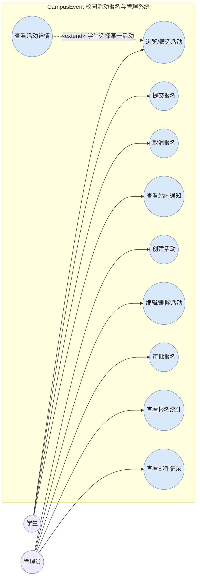
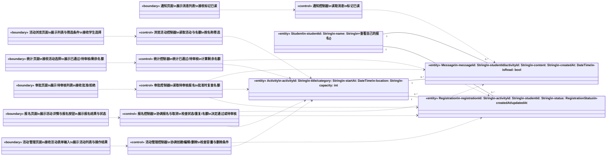
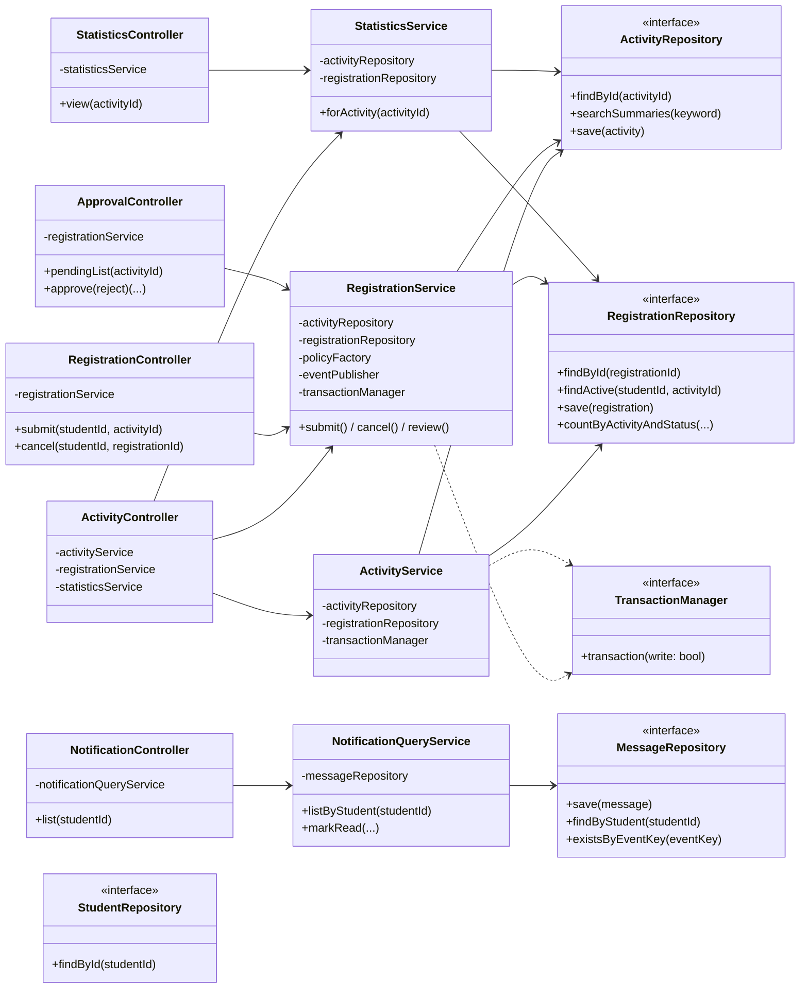
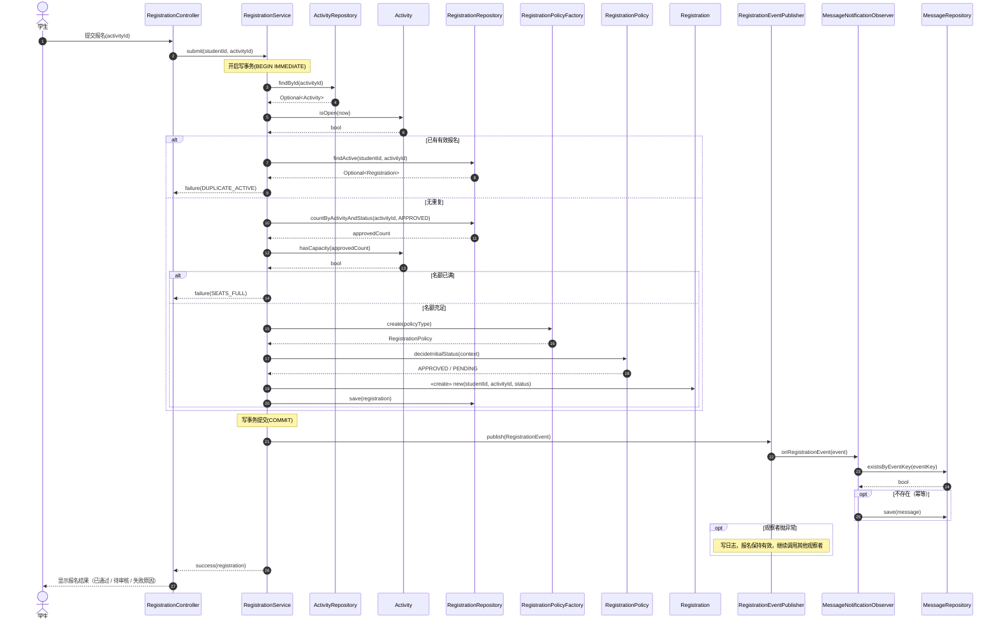
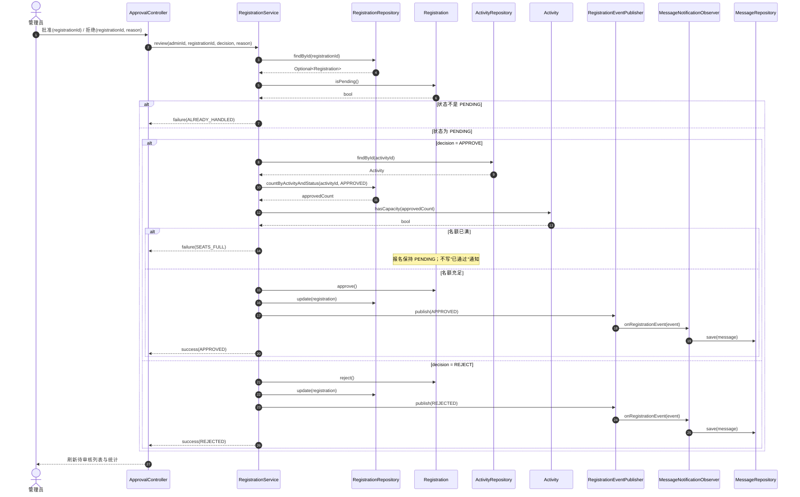
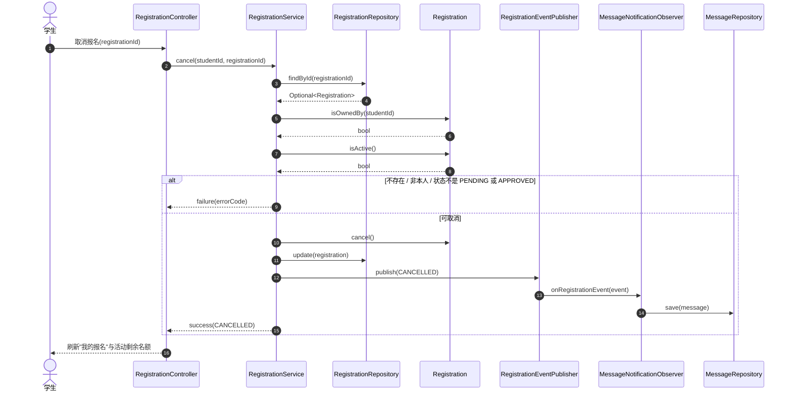
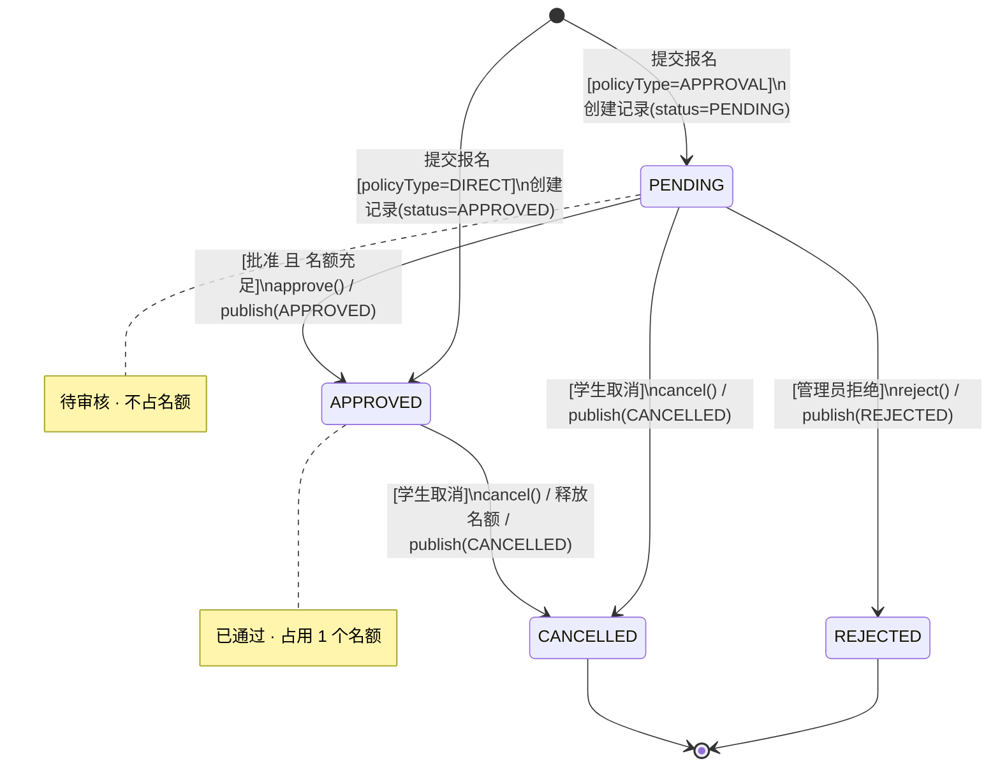
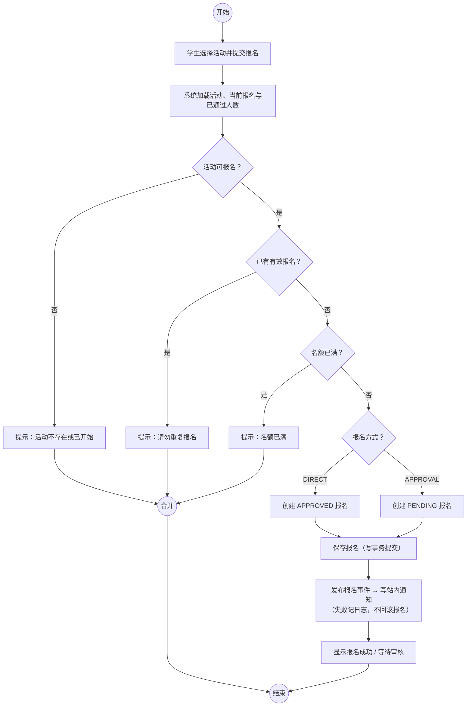

# CampusEvent · 实验二/附录B 图件汇总（mermaid 重绘版）

> 版本：change-v2（baseline-v1 + CR-01/CR-02）｜ 日期：2026-11-26
> 依据：`《软件工程》实验指导书` 实验二（3.1～3.8）、附录 B（B.1～B.3）、教师变更单
> 说明：以下 Mermaid 以 `uml/*.drawio` 源文件为结构基准重绘；Mermaid 保留 baseline 主结构，CR-01/CR-02 的新增细节（年级规则、邮件观察者、邮件记录页）以 `.drawio` 与设计说明书第 13 部分为准；UC9 已补入用例图。

---

## 一、需求实现核对结论（一句话版）

**图件（UML/用例/时序图）已全部就绪，无缺失；baseline-v1 与 change-v2 均已完成，59 个自动化测试通过。**

**change-v2 已按教师变更单实现 CR-01（年级限定报名）与 CR-02（模拟邮件通知）**：新增资格规则、邮件记录与 UC9，更新用例图、分析类图、设计类图、三张顺序图、活动图、状态图；变更影响分析、回归表、验收证据与指标见 `docs/CR-01-CR-02-影响分析.md`、`docs/需求验收表.md`、`uml/设计说明书.md` 第 13 部分。

---

## 二、图件清单（9 张，全部就绪）

| # | 图 | 对应 drawio | 需求出处 |
|---|---|---|---|
| 1 | 用例图 | `01-usecase.drawio` | 3.3 任务D、B.3 |
| 2 | 分析类图（ECB） | `03-analysis-class.drawio` | 3.3 任务A、B.3 |
| 3 | 设计类图（一）领域/策略/事件 | `06-design-class.drawio` | 3.3 任务A/B/C |
| 4 | 设计类图（二）分层架构 | `06-design-class-architecture.drawio` | 3.3 任务A |
| 5 | 时序图 · 提交报名 | `07-提交报名-sequence.drawio` | 3.3 任务D、B.3 |
| 6 | 时序图 · 审批报名 | `07-审批报名-sequence.drawio` | 3.3 任务D、B.3 |
| 7 | 时序图 · 取消报名 | `07-取消报名-sequence.drawio` | 3.3 任务D |
| 8 | 状态图 · 报名生命周期 | `09-state.drawio` | B.3 |
| 9 | 活动图 · 报名流程 | `10-activity-报名流程.drawio` | B.3（辅助） |

---

## 三、图件可视化

### 3.1 用例图

初始版本 P2-F01～P2-F08 + CR-01/CR-02；参与者：学生、管理员；固定演示账号，不实现注册/登录。UC9 为 CR-02 新增；UC4 含年级资格备选流。

> CR-01 的年级资格不是独立用例，作为 UC4 的备选流；UC9 是 CR-02 新增的管理员只读用例。权威关系以 `01-usecase.drawio` 为准。

### 3.2 分析类图（ECB：Boundary–Control–Entity）

分析阶段只表达业务职责，不出现 Service/Policy/Observer/DAO/数据库等设计决策。

### 3.3 设计类图（一）：领域模型、报名策略与领域事件

```mermaid
classDiagram
    direction LR

    class Student {
        -studentId: String
        -name: String
        +getId() String
        +getName() String
    }
    class Activity {
        -activityId: String
        -title: String
        -category: String
        -startAt: DateTime
        -location: String
        -capacity: int
        -policyType: PolicyType
    }
    class Registration {
        -registrationId: String
        -activityId: String
        -studentId: String
        -status: RegistrationStatus
        -createdAt: DateTime
        -updatedAt: DateTime
        +isActive() bool
        +approve()
        +reject()
        +cancel()
    }
    class Message {
        -messageId: String
        -studentId: String
        -activityId: String
        -content: String
        -createdAt: DateTime
        -isRead: bool
    }

    class RegistrationStatus {
        <<enumeration>>
        PENDING
        APPROVED
        REJECTED
        CANCELLED
    }
    class PolicyType {
        <<enumeration>>
        DIRECT
        APPROVAL
    }
    class ApprovalDecision {
        <<enumeration>>
        APPROVE
        REJECT
    }
    class RegistrationEventType {
        <<enumeration>>
        SUBMITTED
        APPROVED
        REJECTED
        CANCELLED
    }

    class RegistrationContext {
        -studentId: String
        -activity: Activity
        -now: DateTime
        -approvedCount: int
        +getActivity()
        +getNow()
        +getApprovedCount()
    }
    class RegistrationResult {
        -success: bool
        -registration: Optional~Registration~
        -errorCode: String
        -message: String
        +isSuccess() bool
    }
    class ActivityStatistics {
        -activityId: String
        -capacity: int
        -approvedCount: int
        -pendingCount: int
        -remaining: int
    }
    class ActivitySummary {
        -activityId/title/category: String
        -startAt/location: DateTime/String
        -capacity/approvedCount: int
    }
    class RegistrationSummary {
        -registrationId/studentId: String
        -studentName/activityTitle: String
        -status: RegistrationStatus
    }

    class RegistrationEvent {
        -eventId: String
        -registrationId: String
        -activityId: String
        -studentId: String
        -type: RegistrationEventType
    }

    class RegistrationPolicy {
        <<interface>>
        +policyType() PolicyType
        +decideInitialStatus(context) RegistrationStatus
    }
    class DirectRegistrationPolicy {
        +decideInitialStatus() -> APPROVED
    }
    class ApprovalRegistrationPolicy {
        +decideInitialStatus() -> PENDING
    }
    class RegistrationPolicyFactory {
        -policies: Map
        +register(policy)
        +get(policyType)
    }

    class RegistrationEventPublisher {
        <<interface>>
        +subscribe(observer)
        +publish(event)
    }
    class RegistrationObserver {
        <<interface>>
        +onRegistrationEvent(event)
    }
    class SimpleRegistrationEventPublisher {
        -observers: List
        -failureLogger
        +publish(event)
    }
    class MessageNotificationObserver {
        -messageRepository
        +onRegistrationEvent(event)
    }
    class NotificationFailureLogger {
        -logPath: String
        +log(event, error)
    }

    Student "1" -- "0..*" Registration
    Activity "1" -- "0..*" Registration
    Student "1" -- "0..*" Message
    Activity "1" -- "0..*" Message

    Registration ..> RegistrationStatus
    Activity ..> PolicyType

    DirectRegistrationPolicy ..|> RegistrationPolicy
    ApprovalRegistrationPolicy ..|> RegistrationPolicy
    RegistrationPolicyFactory --> RegistrationPolicy

    SimpleRegistrationEventPublisher ..|> RegistrationEventPublisher
    MessageNotificationObserver ..|> RegistrationObserver
    SimpleRegistrationEventPublisher --> RegistrationObserver
    SimpleRegistrationEventPublisher --> NotificationFailureLogger
```

### 3.4 设计类图（二）：分层架构、控制器、服务与 Repository 接口

依赖方向：界面层 → 应用服务层 → Repository 接口（依赖倒置，组合根装配实现）。

### 3.5 时序图 · 提交报名（UC4）

### 3.6 时序图 · 审批报名（UC6）

### 3.7 时序图 · 取消报名（UC5）

### 3.8 状态图 · 报名记录 Registration 生命周期

### 3.9 活动图 · 学生提交报名（UC4）

---

## 四、功能需求实现核对（实验二 P2-F01～F08 + 附录 B）

| 编号 | 功能模块 | 需求要点 | 实现状态 |
|---|---|---|---|
| P2-F01 | 活动管理 | 管理员创建/编辑/删除活动，设置名称、类型、时间、地点、人数上限、报名方式 | ✅ 已实现 |
| P2-F02 | 活动查看 | 学生浏览列表/详情，按名称筛选 | ✅ 已实现 |
| P2-F03 | 报名/取消 | 学生报名、取消；禁止重复有效报名 | ✅ 已实现 |
| P2-F04 | 报名策略 | 直接报名自动通过；审核型进入待审核（策略模式） | ✅ 已实现 |
| P2-F05 | 审批操作 | 管理员批准/拒绝；批准时再次检查名额 | ✅ 已实现 |
| P2-F06 | 状态管理 | 待审核/已通过/已拒绝/已取消，状态转换符合规则 | ✅ 已实现 |
| P2-F07 | 站内通知 | 报名/审核结果写入站内消息（观察者/事件解耦） | ✅ 已实现 |
| P2-F08 | 统计 | 按活动查看已通过数、待审核数、剩余名额 | ✅ 已实现 |
| CR-01 | 年级限定 | 活动可设允许年级；仅指定年级可报名；不符时明确拒绝 | ✅ 已实现（CR1-01～05） |
| CR-02 | 模拟邮件 | 直接通过/审核通过/审核拒绝写模拟邮件；失败不回滚；重复不重发 | ✅ 已实现（CR2-01～05） |

**附录 B 业务规则（B.2，7 条）** 全部实现；C1～C10、E1～E10、CR1/CR2 全部通过（详见 `docs/需求验收表.md`，**59/59 通过**）。

---

## 五、变更阶段完成情况

| # | 事项 | 状态 |
|---|---|---|
| 1 | 需求变更影响分析（CR-01/CR-02） | ✅ `docs/CR-01-CR-02-影响分析.md` |
| 2 | 变更版 UML（用例/分析/设计/顺序/活动/状态） | ✅ 已重新生成并通过校验 |
| 3 | 两版 Git 标签 | baseline-v1 已有；change-v2 本地已创建，待推送 |
| 4 | 回归测试表（变更后） | ✅ 59/59 通过，见验收表 |
| 5 | 可维护性对照（新增类数/改核心类数/回归失败数/AI轮次/时长） | ✅ 14 类型 / 4 核心类 / 0 失败 / 2 轮 / 约 52 分钟 |
| 6 | 项目总结（5～8 页） | 待用户确认是否单独成文 |
| 7 | 云服务器部署 | ✅ README §6 |
| 8 | 设计材料评审签字 | 待用户复核后补填 |

---

## 六、原始 drawio 文件索引

| drawio 源文件 | 对应本章节 |
|---|---|
| `uml/01-usecase.drawio` | 3.1 用例图 |
| `uml/03-analysis-class.drawio` | 3.2 分析类图 |
| `uml/06-design-class.drawio` | 3.3 设计类图（一） |
| `uml/06-design-class-architecture.drawio` | 3.4 设计类图（二） |
| `uml/07-提交报名-sequence.drawio` | 3.5 时序图 |
| `uml/07-审批报名-sequence.drawio` | 3.6 时序图 |
| `uml/07-取消报名-sequence.drawio` | 3.7 时序图 |
| `uml/09-state.drawio` | 3.8 状态图 |
| `uml/10-activity-报名流程.drawio` | 3.9 活动图 |
